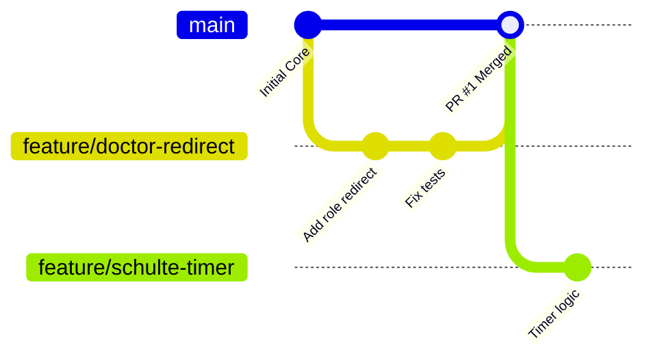

# 🏥 ОНМК 2.0: Регламент командной разработки и запуск проекта

> Руководство по локальному развертыванию платформы, правилам ветвления Git и процедуре прохождения Code Review.

---

## 1. Получение доступа к репозиторию

1. Откройте email, привязанный к вашему аккаунту GitHub, найдите письмо от GitHub с темой **«nikitakashitsyn invited you to nikitakashitsyn/onmk_big»** и нажмите **View invitation**.
   * *Прямой переход:* [https://github.com/nikitakashitsyn/onmk_big/invitations](https://github.com/nikitakashitsyn/onmk_big/invitations).
2. Нажмите зеленую кнопку **Accept invitation**.
3. **Важно:** без принятия приглашения удаленный сервер отклонит отправку (`git push`) ваших веток с ошибкой `Permission denied`.

---

## 2. Пошаговое локальное развертывание (Первый запуск)

### Системные требования
* **PHP:** `8.1` (с расширениями `pdo_mysql`, `mbstring`, `fileinfo`, `gd`, `zip`)
* **Composer:** `2.x`
* **MySQL:** `5.7+` или `8.x` / MariaDB `10.4+` (OpenServer, Laragon или служба Windows)
* **Git:** `2.30+`

---

### Шаг 2.1. Клонирование и настройка окружения

Откройте терминал (PowerShell или Git Bash) в рабочей директории и выполните:

```powershell
# 1. Клонирование репозитория
git clone https://github.com/nikitakashitsyn/onmk_big.git
cd onmk_big

# 2. Создание локального конфигурационного файла
Copy-Item .env.example .env

# 3. Установка PHP-пакетов
composer install

# 4. Генерация ключа приложения
php artisan key:generate

# 5. Создание симлинка для публичных файлов (нужно для хранения аудио/TTS)
php artisan storage:link
```

---

### Шаг 2.2. Конфигурация файла `.env`

Откройте файл `.env` в редакторе и настройте блок подключения к базе данных под ваш локальный сервер:

```env
DB_CONNECTION=mysql
DB_HOST=127.0.0.1
DB_PORT=3306
DB_DATABASE=onmk
DB_USERNAME=root
DB_PASSWORD=
```

---

### Шаг 2.3. Распаковка и импорт базы данных

Дамп базы данных поставляется в сжатом виде в папке `database/dump/onmk_backup.zip`.

1. **Распаковка архива в PowerShell:**
   ```powershell
   Expand-Archive -Path "database\dump\onmk_backup.zip" -DestinationPath "database\dump" -Force
   ```

2. **Создание базы данных:**
   Создайте пустую базу данных с именем **`onmk`** и кодировкой **`utf8mb4_unicode_ci`** (через phpMyAdmin, DBeaver или консоль MySQL):
   ```sql
   CREATE DATABASE `onmk` CHARACTER SET utf8mb4 COLLATE utf8mb4_unicode_ci;
   ```

3. **Импорт SQL-дампа:**
   * **Через консоль:**
     ```powershell
     mysql -u root -p onmk < database\dump\onmk.sql
     ```
   * **Через phpMyAdmin:** выберите созданную базу `onmk` $\rightarrow$ вкладка **«Импорт»** $\rightarrow$ выберите файл `database/dump/onmk.sql` $\rightarrow$ нажмите **«Вперед»**.

---

### Шаг 2.4. Сброс кэша и запуск локального сервера

```powershell
# Очистка и прогрев кэша Laravel
php artisan optimize:clear

# Запуск встроенного веб-сервера
php artisan serve
```

*Проверка:* перейдите в браузере по адресу `http://127.0.0.1:8000`. Если главная страница платформы и форма входа открываются без ошибок базы данных, проект успешно настроен.

---

## 3. Регламент работы с Git

> [!CAUTION]
> **Прямой пуш в ветку `main` строго заблокирован правилами репозитория!**  
> Любая работа ведется исключительно через изолированные ветки и Pull Requests.



---

### Шаг 3.1. Создание рабочей ветки

Перед началом работы над любой задачей обязательно обновите локальный `main`:

```powershell
# Переход в main и подтягивание свежих изменений
git checkout main
git pull origin main

# Создание и переход в новую ветку под задачу
git checkout -b feature/краткое-название
```

#### Стандарты именования веток:
* `feature/<название>` — разработка нового функционала (напр. `feature/doctor-redirect`, `feature/tts-cache`).
* `fix/<название>` — устранение найденных багов (напр. `fix/schulte-saving`, `fix/login-form-error`).
* `refactor/<название>` — рефакторинг кода, стили, верстка без изменения бизнес-логики (напр. `refactor/navbar-ui`).

---

### Шаг 3.2. Коммиты и отправка ветки на GitHub

1. **Проверка измененных файлов перед фиксацией:**
   ```powershell
   git status
   ```
   *Убедитесь, что в коммит случайно не попали файлы `.env`, распакованный `onmk.sql` или временные логи.*

2. **Фиксация коммита:**
   ```powershell
   git add .
   git commit -m "feat(doctor): добавлен ролевой редирект для личного кабинета врача"
   ```

3. **Отправка ветки в репозиторий:**
   ```powershell
   # Флаг -u нужен только при первой отправке ветки
   git push -u origin feature/название-вашей-ветки
   ```

---

### Шаг 3.3. Создание Pull Request (PR)

1. Откройте репозиторий [https://github.com/nikitakashitsyn/onmk_big](https://github.com/nikitakashitsyn/onmk_big).
2. Нажмите появившуюся сверху кнопку **Compare & pull request**.
3. Заполните карточку PR по следующему шаблону:

```markdown
### 📋 Что сделано
- Реализован автоматический редирект для роли ROLE_DOCTOR на маршрут /patients.
- Добавлена фильтрация неавторизованных запросов в HomeController@index.

### 🧪 Как проверить изменения локально
1. Авторизоваться под врачом (login: doc_test, pass: 123456).
2. Перейти на главную страницу http://127.0.0.1:8000/ — должен произойти переход на /patients.

### 📁 Затронутые файлы
- app/Http/Controllers/HomeController.php
- routes/web.php
```

4. В поле **Reviewers** справа выберите Никиту (`nikitakashitsyn`).
5. Нажмите **Create pull request**.

---

### Шаг 3.4. Исправление замечаний после Code Review

Если в процессе проверки тимлид оставил комментарии или запросил правки:
1. Не создавайте новую ветку и не закрывайте текущий PR.
2. Внесите необходимые правки в файлы в той же рабочей ветке.
3. Отправьте новый коммит:
   ```powershell
   git add .
   git commit -m "fix(review): исправлена валидация по замечаниям ревью"
   git push
   ```
4. Pull Request на странице GitHub обновится автоматически. После нажатия тимлидом кнопки **Merge** ветка вольется в `main`.

---

## 4. Решение частых проблем (Troubleshooting)

| Проблема | Причина | Решение |
|---|---|---|
| `fatal: Authentication failed` | Пароли к GitHub больше не поддерживаются терминалом | Сгенерируйте **Personal Access Token (classic)** на GitHub: `Settings` $\rightarrow$ `Developer settings` $\rightarrow$ `Personal access tokens` $\rightarrow$ выберите скоуп `repo` и используйте токен вместо пароля |
| `Updates were rejected because the remote contains work` | В `main` появились изменения других участников | Выполните `git pull --rebase origin main` внутри вашей ветки, разрешите конфликты (если есть) и повторите `push` |
| `Class 'ZipArchive' not found` | В `php.ini` выключено расширение ZIP | Откройте `php.ini`, раскомментируйте строку `extension=zip` и перезапустите PHP |
| 500 Server Error при загрузке картинок / TTS | Отсутствует символическая ссылка хранилища | Выполните в терминале команду: `php artisan storage:link` |
| Ошибки прав доступа к сессиям/кэшу | Засорился кэш старых манифестов | Выполните `php artisan optimize:clear` |